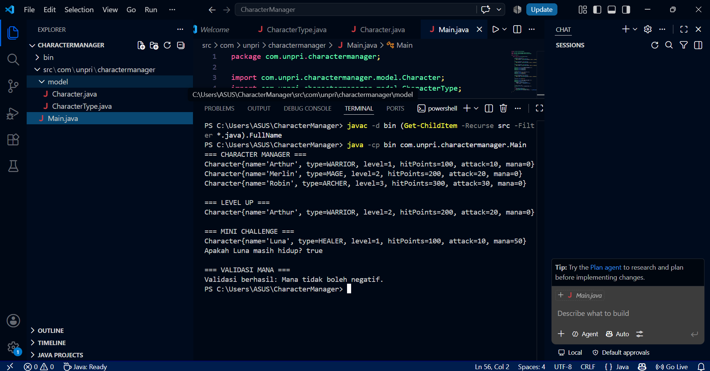

# Character Manager — TP3 (Java Visual SIH-6406)

## Deskripsi

Program ini dibuat menggunakan Java untuk mengelola data karakter. Program menampilkan tiga karakter, mencoba fitur level up, dan menambahkan fitur mana serta isAlive().

## Screenshot Output



## Struktur Folder

```text
CharacterManager/
├── bin/
├── src/
│   └── com/unpri/charactermanager/
│       ├── model/
│       │   ├── Character.java
│       │   └── CharacterType.java
│       └── Main.java
├── screenshots/
│   └── output.png
└── README.md
```

## Identitas Mahasiswa

- Nama: Refalin Echa Tiarma Silaban
- NIM: 253303621265
- Kelas: 3PAGIB

## Analisis Desain

Link Google Docs: https://docs.google.com/document/d/1oBb56zuPdNNHZe6EV0b_abqxww5cIXs-dns3gTZaIV0/edit?tab=t.0